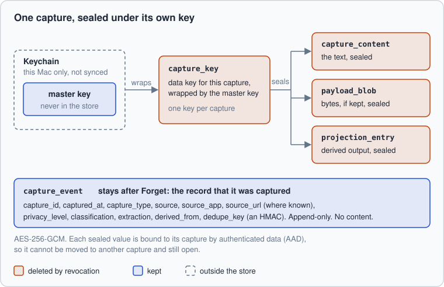
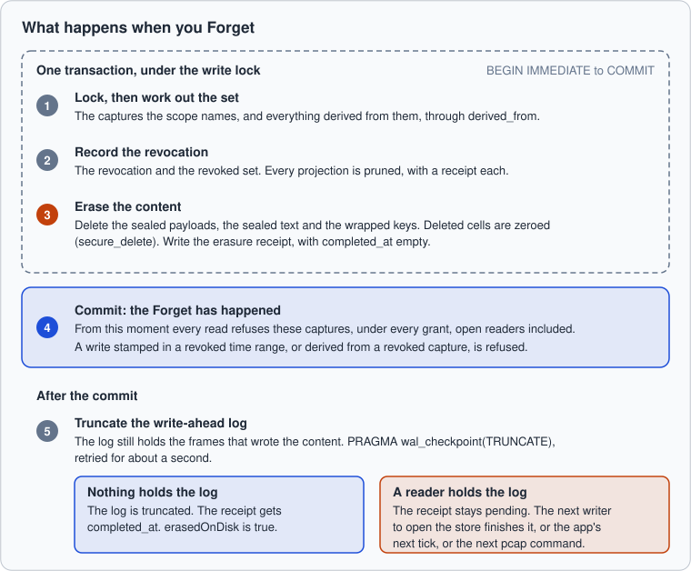
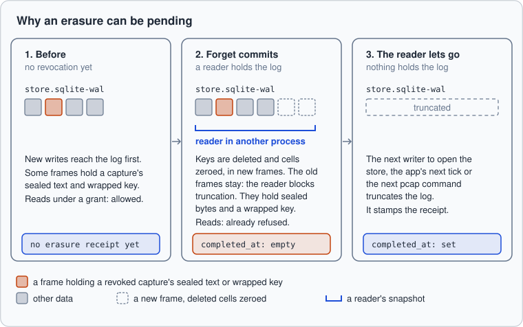

# How revocation works

Forget erases captures from your Mac. This page says what that means: what the
store does, in what order, how that's checked, and what it can't promise.

It's for a reader who wants to verify the claim, not take it on trust. Each
statement names the code or the test behind it. Where an ADR states a limit,
the limit is stated here too. This is 0.x software, and it hasn't been
independently audited ([faq.md](faq.md)).

## The short version

You start a Forget from the menu (**Forget the Last 15 Minutes…** or **Forget the
Last Hour…**), from `pcap forget`, or by retention, which ages captures out on a
schedule. For the captures it names, and everything derived from them:

1. **Content is deleted in one transaction.** The sealed text, the sealed bytes
   and the wrapped key go in the same transaction that records the revocation.
   There's no moment when a revocation is recorded and its content can still be
   read through the store.
2. **Nothing reads them afterward.** Every read path refuses them, under every
   grant, including a reader that was already open.
3. **They can't come back.** A new capture stamped inside a revoked time range,
   or derived from a revoked capture, is refused.
4. **The disk is cleaned up.** The store folds the write-ahead log into the
   database and truncates it. If a reader in another process holds the log,
   that waits. The receipt says so, and a later writer finishes the job.

What Forget doesn't do: reach copies an agent already read, backups made before
it, or the record that the capture happened. See
[What Forget doesn't guarantee](#what-forget-doesnt-guarantee).

## What is stored, and how it's sealed

A capture has two parts. One is the record that it happened. The other is what
was captured. They live in different tables on purpose
([ADR 0002](adr/0002-erasable-revocation.md)). Revocation erases the content and
keeps the record, so you can still say "an agent read a capture from Notes at
14:02" after the content is gone.



- **One key per capture.** Each capture gets its own random 256-bit data key.
- **Sealed, not just stored.** Text, payload bytes and projection outputs are
  sealed with AES-256-GCM, laid out as nonce, ciphertext, tag. That's the
  layout of CryptoKit's `SealedBox.combined`, so the Swift and JavaScript stores
  open each other's files.
- **Bound to the capture.** Each sealed value carries authenticated data
  (`text:<capture_id>`, `payload:<capture_id>`,
  `projection:<name>:<capture_id>:<ref>`). A sealed value moved to another
  capture won't open.
- **The data key is wrapped.** It's stored sealed by a master key, with
  authenticated data `key:<capture_id>`. The master key lives in the Keychain
  on this Mac, never synced. The store never writes it. A store refuses to open
  with another key, even when every capture in it has been revoked
  (`key_check`, migration 009).
- **No plaintext on disk.** Exclusion comes first, then redaction, then
  sealing, then the write ([CONTRACT.md](https://github.com/futurepitcher/presence-capture/blob/main/packages/daemon/CONTRACT.md)). The
  forensic check below looks for plaintext as well as for revoked bytes.
- **Identical content is stored twice.** Two captures with the same bytes are
  sealed under two keys, so either can be erased alone.

| Table | Holds | At Forget |
|-------|-------|-----------|
| `capture_event` | When, type, source, app, URL where known, privacy level, `derived_from`, dedupe key | Stays. Append-only. Holds no content |
| `capture_payload` | Hash, size and media type of a payload | Stays |
| `capture_key` | The wrapped data key | Deleted |
| `capture_content` | The text, sealed | Deleted |
| `payload_blob` | The payload bytes, sealed | Deleted |
| `projection_entry` | What a projector derived, sealed under the source capture's key | Deleted, with a receipt for each projection |
| `revocation`, `revoked_capture`, `erasure_receipt`, `projection_revocation` | The record of the Forget | Written. Append-only |
| `egress_record` | What each agent was served: capture ids and counts, never content | Stays |

On a Mac, `payload_blob` is empty by default. Screen captures are text
([ADR 0005](adr/0005-text-first-capture.md)), and no audio is kept. What gets
sealed in practice is text.

## What Forget does

| Way in | What it revokes |
|--------|-----------------|
| **Forget the Last 15 Minutes…**, **Forget the Last Hour…** in the menu | A `time_range`: from 15 or 60 minutes ago to now |
| `pcap forget 15m` (minutes or hours, up to a day) | The same, from a terminal |
| **Keep Captures For** (retention) | A `time_range` from the epoch to now minus the period, with reason `retention` |
| The store's `revoke` call | A `capture`, a `time_range`, a `source` or a `privacy_level` |

The app asks first, because a Forget can't be undone.

Forget isn't the same as withdrawing a grant. `pcap grant revoke` stops one agent
from reading more, and erases nothing. Forget erases captures for everyone,
you included.

A scope names captures like this:
- **`capture`**: that one capture.
- **`time_range`**: every capture with `captured_at` from the first time to the
  second, both ends included. Both times are kept in one canonical form, so
  the text comparison is exact.
- **`source`**: every capture whose `source` or `source_app` matches, such as
  `sensor:git-activity`.
- **`privacy_level`**: every capture at that level.



The code is `revoke()` in
[`store.js`](https://github.com/futurepitcher/presence-capture/blob/main/packages/schema/src/store.js), and `revoke` in the Swift
[`Store.swift`](https://github.com/futurepitcher/presence-capture/blob/main/packages/daemon/Sources/CaptureStore/Store.swift). The Swift
store takes the same steps in the same order.

1. **Lock, then work out the set.** The store takes the write lock
   (`BEGIN IMMEDIATE`) before it reads anything. A capture another writer commits
   while Forget waits is either in the set or refused afterward. It can't slip
   between. The set is the captures the scope names, plus everything derived from
   them, followed through `derived_from` as far as it goes. This is done in SQL,
   in a temporary table kept in memory (`temp_store = MEMORY`), so the list of
   what's being revoked isn't written to a temporary file. A scope of any size
   works.
2. **Record it, and prune projections.** A `revocation` row, and one
   `revoked_capture` row for each capture reached. `cascaded` is 1 for one reached
   through `derived_from`. Revocations are append-only: a trigger refuses to
   update or delete one. Every projection then loses its entries for the set, and
   gets a `projection_revocation` row saying how many, even when it's zero.
3. **Erase.** Delete the sealed payloads, the sealed text and the wrapped keys,
   then write the `erasure_receipt` with the counts. The store runs with
   `secure_delete = ON`, so deleted cells are zeroed, not left on a free page.
4. **Commit.** From here nothing can make the Forget not have happened.
5. **Truncate the log.** See
   [Erasure from disk](#erasure-from-disk-and-why-it-can-be-pending).

### Derived data

Revocation follows `derived_from`, all the way down. Revoke an audio segment and
its transcript goes with it, and so does an alignment of that transcript, whatever
their own timestamps. This is requirement R10 in
[SCHEMA.md](spec/SCHEMA.md), and `store R10` in `revocation.test.js` tests it.

Anything a projector derived from a capture is sealed under that capture's key.
Revoking the capture deletes the entry and the key that sealed it
([ADR 0007](adr/0007-plugins.md)). Anything derived from several captures is
never written to disk. It's computed in memory, and computed again from what
remains when any source is revoked
([ADR 0008](adr/0008-recall-indexes-in-memory.md)).

In 0.1 on a Mac, the derived captures are transcripts. Sessions are computed in
memory and never stored. The app runs no projector and keeps no embeddings
(ADR 0008, amended), although the store's side of both is built and tested.

### After the commit: reads

Every read has two parts
(`twoPhase` in `store.js`, and in `ReadPath.swift`):

1. **Choose.** Under a read snapshot, which never holds the write lock, the store
   picks what the grant admits and unseals it. A search through a long history
   doesn't keep a Forget waiting. The grant's filter always includes
   `capture_id NOT IN (SELECT capture_id FROM revoked_capture)`.
2. **Serve.** In one transaction under the write lock, the store checks the grant
   again, drops any capture revoked since step 1, and writes the egress record.

So a Forget that commits while a read is in flight takes effect on that read.
A reader can be kept and reused, and each of its reads looks its grant up
afresh. A reader opened before the Forget gets nothing it shouldn't.

Two more things back that up:
- **The key is gone.** A revoked capture can't be unsealed, whatever a buggy
  read path asked for. Its content reads back as `null`
  (`revocation.test.js`, "revocation erases content and writes an erasure
  receipt").
- **The reader's memory catches up.** `pcap-mcp` keeps a keyword index in memory
  ([ADR 0008](adr/0008-recall-indexes-in-memory.md)). It looks for new
  revocations at the start of each call, and evicts the captures they name.
  Every answer is then served again by id through the store, so a lagging
  eviction serves nothing.

The tests: `store T3`, `store ADR 0001` (reads by id and of outputs) and
`recall.test.js`, in which another writer forgets a capture just as an answer
is served. The MCP conformance test `recall: a capture made after the server
started is found, and a revoked one is gone` covers a live server.

A read that happened before the Forget stays in the egress log, as capture ids.
The log is append-only, and revoking doesn't redact it
([ADR 0001](adr/0001-serving-trust-boundary.md) §4.2).

### After the commit: writes

A capture can arrive after the moment it records. Speech is written once it's
transcribed, and a screen once it's read. Without a rule, that capture would
land after the Forget and be readable. So the store refuses
(`refuseForgotten`, requirement R13):
- an append whose `captured_at` falls inside any revoked `time_range`, retention's
  included;
- an append whose `derived_from` names a revoked capture;
- a projection entry for a revoked capture.

The driver protocol reports this as `constraint`. Other scopes forget what
exists, not what's to come. A revoked source can be captured again. Exclusion
([quickstart.md](quickstart.md)) is how you stop an app from being captured.

## Erasure from disk, and why it can be pending

Deleting rows isn't enough. The store runs SQLite in write-ahead log mode, so the
frames that wrote the content are still in the log file after the rows are gone,
even though the deleted cells are zeroed. The store therefore finishes with
`PRAGMA wal_checkpoint(TRUNCATE)`, which folds the log into the database and
empties it.

A reader in another process, such as an MCP server in the middle of a read,
holds a snapshot of the log and blocks that. SQLite doesn't raise an error.
It says so only in the result row (`busy = 1`). The store retries for about a
second (20 tries, 50 ms apart). If the log is still held, it does this:

- **The Forget stands.** The keys are already gone from the database, and every
  read path already refuses the captures.
- **The result says so.** `erasedOnDisk` is `false` (`erased_on_disk` in the
  driver protocol). The menu says the captures "were revoked and can't be read"
  and that their last traces will be erased as soon as the store can finish.
  `pcap forget` prints "on-disk erasure pending, while a reader holds the
  store's log".
- **The receipt stays open.** `erasure_receipt.completed_at` is `NULL`.



Until the log is truncated, the revoked sealed bytes and wrapped keys are still
in the log file. The held-log test scans for exactly those. Anyone who held that
file and the master key could read them. Through Presence Capture, no one can.

**Who finishes it.** `completed_at` is kept in the store, not in the memory of
the process that revoked, because that process may have exited. A command-line
Forget can run while an MCP server reads. Any of these truncates the log and
stamps the receipt, once it can:
- any writer that opens the store, such as the app at launch or the next `pcap`
  command;
- the app, on its next tick (5 seconds by default);
- `pcap check`, which tries to finish it, then prints `erasure: complete` or
  `erasure: pending, while a reader holds the store's log`.

The stamp only covers revocations committed before the truncation began. A
revocation another writer commits after that, while a reader holds the log
again, stays pending.

## Receipts

| Receipt | Says |
|---------|------|
| `revocation` | What was named: the scope, the time and the reason, such as `forget 15m` or `retention` |
| `revoked_capture` | Each capture reached, and whether through `derived_from` |
| `projection_revocation` | For each projection, how many entries were removed. A projection with no receipt for a revocation is non-conformant, even when its entries are gone |
| `erasure_receipt` | `keys_destroyed`, `contents_erased`, `payloads_erased`, and `completed_at`, set once the log was truncated |

All of them are append-only. The only change allowed is stamping `completed_at`,
once. A revocation with no erasure receipt is non-conformant.

To look at the latest few, read the store's file. It's a normal SQLite file, and
this query only reads:

```sh
sqlite3 "$HOME/Library/Application Support/Presence Capture/store.sqlite" \
  "SELECT r.scope_kind, r.scope_value, r.reason, e.keys_destroyed,
          e.contents_erased, e.payloads_erased, e.completed_at
   FROM revocation r JOIN erasure_receipt e USING (revocation_id)
   ORDER BY r.sequence DESC LIMIT 5;"
```

**Expected output**, for a Forget of 30 minutes that took in four captures:
```text
time_range|2026-10-06T09:00:00.000Z/2026-10-06T09:30:00.000Z|forget 30m|4|4|0|2026-10-14T21:59:08.631Z
```

An empty last column means the erasure is pending. A query that ends at once is
harmless. A read transaction left open holds the log and delays the erasure.

## Retention is a scheduled revocation

A store grows without bound unless something removes old content. A timed
delete would be a second way to remove content. It would leave no receipt and
wouldn't reach derived data. So retention is a revocation
([ADR 0003](adr/0003-retention-is-revocation.md)):
- `scope_kind = time_range`, from the epoch to now minus the period;
- `reason = 'retention'`.

It follows `derived_from`, prunes projections and erases content, with the same
receipts as a Forget. You can see that retention removed last month's content,
and when.

- **In the app:** 14 days by default. **Keep Captures For** offers 1 day, 7, 14,
  30, 90 and 1 year. It runs at launch and then every hour. A shorter period
  erases at once, so the app asks first, and keeps the new period only once that
  revocation succeeds.
- **Quiet when there's nothing to do.** `store.retain()` returns `null` and
  writes nothing when no unrevoked capture is old enough, so an hourly schedule
  doesn't fill the log with empty revocations.
- **It reaches derived data.** A transcript goes with its audio, even when the
  transcript is newer. A capture at exactly the cutoff is included.
- **Late captures are refused.** After retention runs, a capture older than its
  cutoff is refused like any capture in a revoked range.
- **It can't be undone**, any more than a Forget can.

## How it's checked

Requirements R2, R3, R10, R11, R12 and R13 in [SCHEMA.md](spec/SCHEMA.md) are
tested by the store layer of the conformance suite. It reaches an implementation
only through the [driver protocol](spec/DRIVER.md), then reads the store's files
directly, so it holds any language to the same bytes. The JavaScript reference and
the Swift `CaptureStore` (through `pcap-driver`) run the same suite in CI.

**The forensic check** (`conformance/store/forensic.js`, run by
`erasure.test.js`) does this, in a real directory:
1. Writes an audio capture with a payload, a transcript derived from it, a
   projector output for the transcript, and an unrevoked control capture.
2. Scans every file the store left (the database, the log, the shared-memory
   file and any blob directory) for plaintext. None may appear, revoked or not.
3. Records the wrapped keys and sealed bytes of the captures about to be revoked.
4. Revokes the audio, while the store is still open. A store mustn't rely on a
   clean close to erase.
5. Scans every file again for those bytes. None may remain.
6. Opens the store with the master key, as someone holding both would. The
   revoked transcript, payload and projector output must not decrypt. The control
   capture must still decrypt, or the check could pass a store that erased
   everything. The erasure receipt must exist, with the right count of keys.

**The check is itself tested.** `mutation.test.js` builds six stores, each with
one erasure step broken from outside, and each must fail the check:
- keys survive;
- sealed text survives;
- the sealed payload survives;
- `secure_delete` is off;
- the log is never truncated;
- no receipt is written.

**The edges are tested too.** `held-log.test.js` holds the log from another
process, and checks that the erasure isn't reported done, and that a later
writer finishes it, even after the revoking process exited. `writers.test.js`
checks the lock, the late-write refusals and a grant revoked by another writer.

To run them (Node 22.13 or later, no dependencies to install):

```sh
cd packages/schema
npm run conformance:store
```

To run only the erasure checks:

```sh
node --test conformance/store/erasure.test.js \
  conformance/store/mutation.test.js \
  conformance/store/held-log.test.js
```

**Expected output** ends with:
```text
ℹ tests 12
ℹ suites 0
ℹ pass 12
ℹ fail 0
```

On a Mac, run the same suite against the Swift store:

```sh
swift build --package-path ../daemon --product pcap-driver
PRESENCE_CAPTURE_DRIVER="$(swift build --package-path ../daemon --show-bin-path)/pcap-driver" npm run conformance:store
```

**On a real Mac.** These tests make stores in a temporary directory, with
synthetic captures. The live forget check,
[`scripts/live-forget-check.mjs`](https://github.com/futurepitcher/presence-capture/blob/main/scripts/live-forget-check.mjs), does the same
to the app's own store while it captures. It pins the log with a read
transaction of its own while you Forget, checks the erasure is pending, then lets
go and checks that none of the forgotten sealed bytes is left in any file under
the store's folder. Its method and results are in [benchmarks.md](benchmarks.md).

## What Forget doesn't guarantee

These are limits, not bugs. ADR 0002 §4 states most of them.

- **Copies already made.** Once an agent has read a capture, what it kept is out
  of this project's hands: its context, its logs, wherever it sends them.
  Forget can't reach into another program. What you can see is what each agent
  was served: **Agents Read…** in the menu, or `pcap egress`, show counts by day,
  tool and type, never content. A sensor plugin is a program that runs as you.
  "Nothing can guarantee what a native program does on its own"
  ([ADR 0007](adr/0007-plugins.md)).
- **Backups made before the Forget.** A backup holds the wrapped key and the
  ciphertext. Anyone with that backup and the master key can still read them.
  Rotating the master key (re-wrapping every live data key, then destroying the
  old master) would close this. It's future work. Until then, "erased" means
  erased from this store and from every copy made after the Forget. Nothing in
  the app marks the store as excluded from backups. Time Machine copies it like
  other files in your Library folder, unless you exclude it.
- **The record stays.** Capture type, time, source app, source URL where
  established, privacy level and payload size remain. A URL can be revealing on
  its own. Revoking a source erases content, not the record that the source was
  used. The egress log keeps the ids of everything it ever served. A dedupe
  key stays too, as an HMAC under a key derived from the master key, so it
  can't be matched to the value it stood for without that key.
- **Memory.** Content unsealed for a read lives in the reading process until it's
  freed, and the reference doesn't scrub it. A running `pcap-mcp` also keeps its
  index until its next call evicts a revoked capture. Swap is macOS's to
  protect. It's encrypted by default on Apple silicon (ADR 0008).
- **A pending erasure.** Between the commit and the log's truncation, the sealed
  bytes may still be in the log file.
- **SSD and filesystem remnants** of SQLite pages are below what `secure_delete`
  can reach. The key-per-capture design is what covers them, not a claim about the
  hardware. Once the wrapped key is gone, a stray copy of the sealed bytes is
  noise. A stray copy of the wrapped key is the backup case above.
- **Only what the scope names.** Forget revokes the captures its scope reaches and
  what is recorded as derived from them. It doesn't search for other captures
  with the same words. The same text on screen an hour ago is a different
  capture.
- **No audit.** The ADRs, the code and the conformance suite are public. Codex
  and Claude have reviewed them. No outside firm has audited them.

If you find revoked content you can recover from the files, that's the most
valuable bug you can report. Do it privately: [SECURITY.md](https://github.com/futurepitcher/presence-capture/blob/main/SECURITY.md).

## Where to look in the code

| What | Where |
|------|-------|
| Sealing | [`seal.js`](https://github.com/futurepitcher/presence-capture/blob/main/packages/schema/src/seal.js), [`Seal.swift`](https://github.com/futurepitcher/presence-capture/blob/main/packages/daemon/Sources/CaptureStore/Seal.swift) |
| Append, late-write refusal, `revoke`, `truncateLog`, `retain` | [`store.js`](https://github.com/futurepitcher/presence-capture/blob/main/packages/schema/src/store.js), [`Store.swift`](https://github.com/futurepitcher/presence-capture/blob/main/packages/daemon/Sources/CaptureStore/Store.swift) |
| The read path | `twoPhase` in `store.js`, [`ReadPath.swift`](https://github.com/futurepitcher/presence-capture/blob/main/packages/daemon/Sources/CaptureStore/ReadPath.swift) |
| The tables and triggers | [`005_erasable_content.sql`](https://github.com/futurepitcher/presence-capture/blob/main/packages/schema/migrations/005_erasable_content.sql), [`008_durable_erasure.sql`](https://github.com/futurepitcher/presence-capture/blob/main/packages/schema/migrations/008_durable_erasure.sql), [`009_key_check.sql`](https://github.com/futurepitcher/presence-capture/blob/main/packages/schema/migrations/009_key_check.sql) |
| The checks | [`conformance/store/`](https://github.com/futurepitcher/presence-capture/tree/main/packages/schema/conformance/store) |
| The requirements | R2, R3, R10 to R13 in [SCHEMA.md](spec/SCHEMA.md) |
| The decisions | [ADR 0001](adr/0001-serving-trust-boundary.md), [ADR 0002](adr/0002-erasable-revocation.md), [ADR 0003](adr/0003-retention-is-revocation.md) |
| What an attacker can and can't do | [threat-model.md](threat-model.md) |
